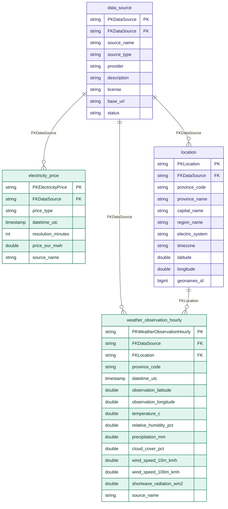

# Silver data model

_Generated from `domain_model/entities/` by `write_data_model_doc`. Do not edit by hand._

- **Table roles** (colours in the diagram): Reference / dimension, Entity (records by source).
- **Entities keep the records of every data source:** the PK includes `source_name`. Resolving several sources into one golden record is the job of MDM (future `<entity>_golden` tables).
- **Every table references `data_source`** through `FKDataSource`.
- **Naming:** "source" always means data source. Energy technologies are a business column called `technology`.

## Data sources

| source_name | source_type | provider | license |
|---|---|---|---|
| `open_meteo_archive` | http_api | Open-Meteo | CC BY 4.0 (attribution required) |
| `open_meteo_forecast` | http_api | Open-Meteo | CC BY 4.0 (attribution required) |
| `public_holidays_es` | http_api | Nager.Date | Free / Community API |
| `ree` | http_api | Red Eléctrica de España (REE) | REE terms of use: reuse allowed citing the source |
| `locations_es` | reference_file | INE (province codes) / GeoNames (capitals and coordinates) | INE: reuse with attribution · GeoNames: CC BY 4.0 (attribution required) |
| `source_specs` | platform_metadata | Data platform (internal) | internal |

## Tables

### `workspace.silver_ai.data_source`
- **Entity:** `data_source` (governance) · role: reference
- **Description:** Data sources of the platform: bronze source specs, reference files and the platform metadata itself.
- **Grain:** one row per data source
- **Primary key:** `PKDataSource` = md5(source_name)
- **Foreign key:** `FKDataSource` = md5('source_specs') → `data_source.PKDataSource`

### `workspace.silver_ai.electricity_price`
- **Entity:** `electricity_price` (energy_market) · role: entity
- **Description:** Electricity price in Spain by price type, at the resolution published by the source (hourly or quarter-hourly), in EUR/MWh and UTC.
- **Grain:** one row per price type and period start (UTC) and data source
- **Primary key:** `PKElectricityPrice` = md5(price_type, datetime_utc, source_name)
- **Foreign key:** `FKDataSource` = md5(source_name) → `data_source.PKDataSource`

### `workspace.silver_ai.location`
- **Entity:** `location` (geography) · role: reference
- **Description:** Spanish provinces with their capital, region, time zone, coordinates and the electric system they belong to.
- **Grain:** one row per Spanish province
- **Primary key:** `PKLocation` = md5(province_code)
- **Foreign key:** `FKDataSource` = md5('locations_es') → `data_source.PKDataSource`

### `workspace.silver_ai.weather_observation_hourly`
- **Entity:** `weather_observation_hourly` (weather) · role: entity
- **Description:** Observed hourly weather for each Spanish province (reference point: the provincial capital), in UTC.
- **Grain:** one row per province and hour (UTC) and data source
- **Primary key:** `PKWeatherObservationHourly` = md5(province_code, datetime_utc, source_name)
- **Foreign key:** `FKDataSource` = md5(source_name) → `data_source.PKDataSource`
- **Foreign key:** `FKLocation` = md5(province_code) → `location.PKLocation`
